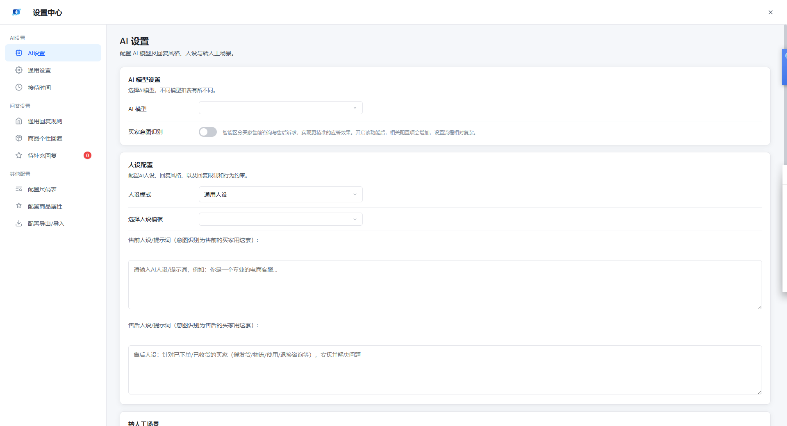
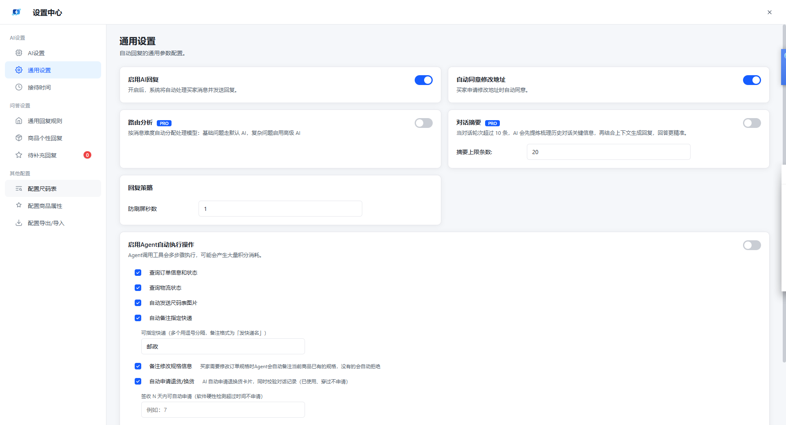

# 快应AI · 电商智能客服工作台

⚡ **面向电商客服的一体化工作台** ⚡

快应AI 围绕电商客服场景打造的桌面工作台，将店铺管理、买家沟通、回复策略配置集中在一个界面，帮助客服/运营更高效地处理日常接待工作。

本项目基于 **PyQt6 + QtWebEngine** 构建，界面采用现代化设计（无边框+系统阴影、顶部店铺标签栏 + 滑动指示线、线框图标的扁平风格）。

🚀 **官网下载**：<https://kuaiyingai.xyz/>

---

## ✨ 产品特色

- 🎯 **专注电商客服场景**：围绕店铺接待、回复策略配置设计
- 🔗 **多店铺统一管理**：顶部标签栏自由切换店铺，一键批量启动
- 🧩 **可配置回复体系**：设置中心内置通用/商品指向等多种回复规则，支持人设与转人工场景配置
- 📊 **接待状态一目了然**：自动回复开关、接待状态指示灯实时反馈
- 🛠 **界面友好**：现代 UI 风格、加载动画、卡片式布局、标签交互

---

## 🔥 核心功能

- ✅ **多店铺管理**：新增/编辑/删除店铺，店铺列表弹窗、一键启动全部店铺
- ✅ **店铺登录**：内置网页加载平台商家后台，扫码/登录进入自己的店铺管理页
- ✅ **顶部店铺标签**：带滑动指示线的浏览器式标签栏，标签与页面高亮联动
- ✅ **自动回复开关**：开启/关闭一键切换，状态同步到所有标签页并实时反馈
- ✅ **回复规则配置**：设置中心支持通用/商品/售前/售后等回复规则，匹配类型与优先级可调
- ✅ **人设与转人工**：AI 人设/提示词配置、转人工场景设置
- ✅ **消息管理入口**：消息中心、黑名单、消息日志
- ✅ **本地持久化**：店铺与配置存于本地用户数据目录，重装/更新不丢


---

## 🖼 界面展示

| |
|---|
|  |
|  |
|  |

---

## 🚀 快速开始

### 环境要求

- Windows 10/11
- Python 3.10+（推荐 3.13）

### 安装

```bash
pip install -r requirements.txt
```

### 运行

```bash
python main_qt.py
```

---

## 📁 目录结构

```
kuaiai-ui-opensource/
├── main_qt.py                 # 程序入口
├── requirements.txt           # 依赖清单
├── fire_browser/
│   ├── browser_tab/           # 店铺登录页
│   ├── main_window/           # 主窗口各零件
│   ├── pathutils.py           # 路径/工具
│   ├── settings_bridge.py     # 设置中心桥
│   ├── widgets.py             # UI 小件
│   └── workers.py             # 后台任务
├── reply-settings-center.html # 设置中心页面
├── ui_widgets.py              # 自绘控件
├── shop_manager.py            # 店铺管理
├── config_manager.py          # 配置管理
├── database.py                # 店铺持久化
├── log_manager.py             # 日志系统
├── icons/                     # 图标/素材
└── logo1.ico
```

---

## 💡 开源贡献

欢迎提交 Issue / Pull Request 完善代码、文档与使用体验。

- 🐛 提交 Issue 反馈问题或建议
- 🔧 提交 PR 贡献代码
- 📝 完善文档与示例

---

## 📞 联系我们

有任何问题需要反馈，或者对产品有功能建议，欢迎扫码添加交流：

| |
|---|
|  |

---

## ⚖️ 使用许可

本项目遵循 [MIT 许可证](LICENSE)。

- ✅ 个人使用：免费，无限制
- ✅ 允许修改、商用、再分发（需保留版权声明）
- 📝 详细条款请见 [LICENSE](LICENSE)

> 说明：本开源版开放软件界面与整体框架代码。如您需要完整的商业版本或定制服务，请联系我们。
>
> ⚠️ **第三方依赖许可**：本项目依赖 **PyQt6（GPL v3）**。本项目源码遵循 MIT，但 PyQt6 本身为 GPL v3 / 商业双许可，使用与分发本软件时须同时满足 PyQt6 的许可证义务（详见 [LICENSE](LICENSE)）。

---

**⭐ 如果这个项目对你有帮助，欢迎点亮 Star！⭐**
